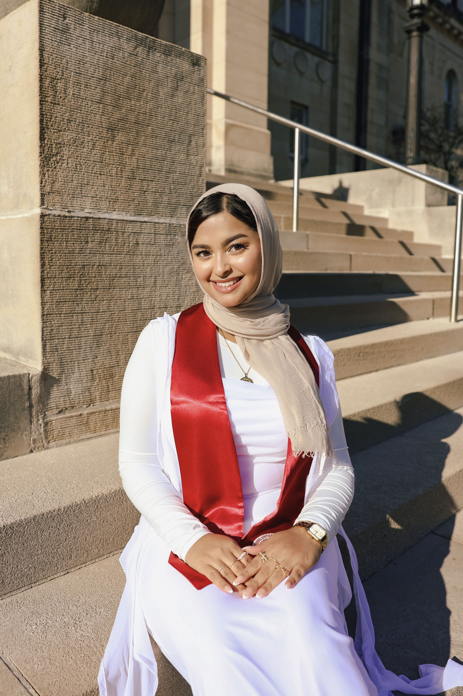

---
title: "About Me"
---

# Hi, I'm Rezwana!

I am a Master of Public Health student at Columbia University Mailman School of Public Health in the Department of Population and Family Health, pursuing a certificate in Public Health Research Methods.

My interest in public health comes from wanting to understand not only how health systems affect individual patients, but also how policy, access, and larger structural factors shape health outcomes across communities. I am interested in health policy, health equity, reproductive and maternal health, and the ways research can be translated into practical improvements in healthcare delivery.

I am particularly excited by work at the intersection of public health, healthcare strategy, data, and emerging technologies. Long term, I hope to build a career that allows me to combine rigorous analysis with patient-centered and population-level thinking to help solve complex healthcare problems.

This website highlights my interests, experiences, and some of the data visualization work I have developed through my Data Science coursework.